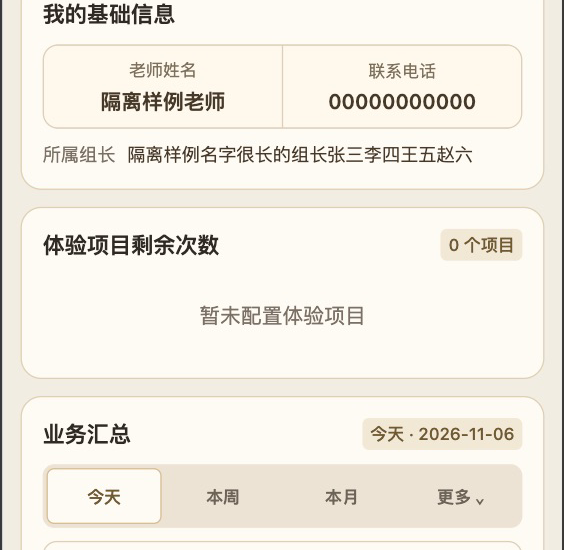

# 所属组长与封存退组：独立部署回执

源码提交：`fafe423cb843f6f7d19cfd07f18711d5e9877732`，已推送 origin/main。只部署本轮字段展示和原子封存规则；未封存任何真实账号做测试。

## 数据库：已执行

环境 `rusizhuoer-d9gbcsgym07651694` 已通过只读预览核对，无历史无效绑定。按 [093执行指引](../../database/cloudbase-console/093-README.md) 顺序完成预览、全库备份门禁和迁移。完整快照覆盖43张public基础表、406行、46个序列；备份清单无行数差异。独立回读五项READY，全部43表与快照逐行双向比较差异0，现有序列、列定义和既有约束／触发器保持；仅新增4个函数、4个触发器（含2个延迟约束触发器），替换1个组内读取函数。充值／核销／余额等八项业务审计均为0异常。真实关系姓名对照读取差异0。

SQL文件状态：

1. [093-preview.sql](../../database/cloudbase-console/093-preview.sql)：只读，已执行。
2. [093-01-teacher-archive-team-release.sql](../../database/cloudbase-console/093-01-teacher-archive-team-release.sql)：已在同一完整备份门禁执行，不重复执行。
3. [093-readonly-verify.sql](../../database/cloudbase-console/093-readonly-verify.sql)：只读，五项READY，已执行。

私有快照、完整数据和原始部署日志保留在本机私有目录，不提交Git。

## 云函数：已部署并验证

|函数|线上版本|官方部署包|独立验收|
|---|---|---|---|
|staffAccount|v101|5个根文件、78.9KB|health v101；官方回下载5个根文件SHA-256全部匹配|
|faceRecognition|v142|7个根文件|health v142；官方回下载7个根文件SHA-256全部匹配|

faceRecognition 照片内存合成探针 `attendancePhotoRuntime.ready=true`，实际Node18.15.0／Linux x64，沿用现有运行时。两次上传串行、路径显式限定到函数目录，无根仓库误打包。其它云函数不变。

可拖入腾讯云的同版本核验包：[staffAccount-v101.zip](../../deployments/staffAccount-v101.zip)、[faceRecognition-v142.zip](../../deployments/faceRecognition-v142.zip)。根README、package版本、运行时、文件清单和归档哈希均一致。

## Web与小程序

Web：仅staff-detail.html、staff-detail.js、staff-team.js三份资源，使用独立暂存目录、空根路径及 `--safe --verify`；官方回执successCount=3、failedCount=0、verified=true，发布备份保留。三个文件独立公网HTTPS读取的SHA-256与仓库逐一一致。

小程序开发版 [0.3.59](../../miniprogram-app/releases/0.3.59.md)：官方最终 `✔ upload`，后台progressSuccess／reportNewRemoteDebug成功，总耗时142267毫秒；主包1713177字节、总包3525071字节。上传前后430份工程文件一致，用户配置原样保留，未重启工具或丢失已有未保存编辑。此版本未选为体验版、未提审、未正式发布。

## 验收范围

全仓707项回归；本轮50项隔离数据库检查；158项业务统计和114项既有小组数据库回归通过。原生隔离项目84份当前UI文件SHA-256与仓库一致，手机与iPad竖横屏完成相关显示检查。电脑独立档案夹具仅使用真实Web模板、样式和控制器，不表示真实账号全站登录验收。详见[逻辑与显示验收](2026-11-06-teacher-archive-team.md)。

封存业务在隔离数据库验证，不为验收生成生产封存、分配、核销或充值数据。没有额外新增封存关联的小组操作记录；既有历史保留。

