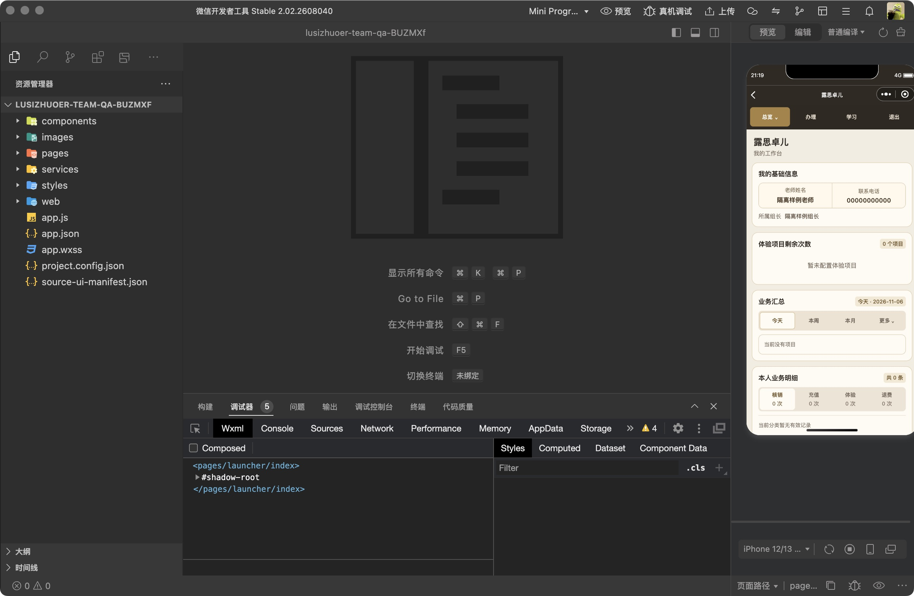
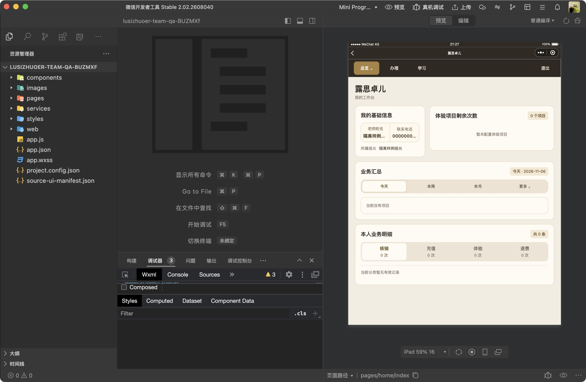
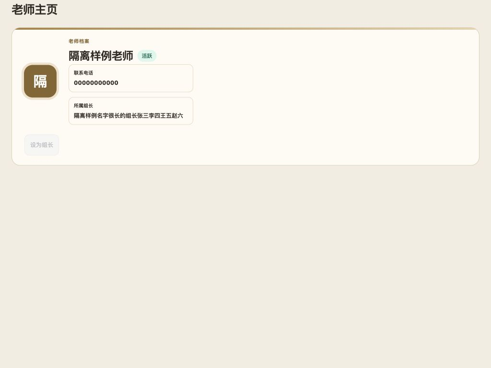

# 老师所属组长与封存退组

最终规则：老师本人主页、总部查看老师和组长授权成员主页显示实时“所属组长”姓名，只有普通文字，不提供组长超链接；没有有效组长时整个字段隐藏。封存普通老师即退组；封存组长同时取消资格、释放全部成员。恢复账号仍为未分配，不恢复组长资格。

用户随后确认“不需要留记录”：封存关联退组、取消资格和释放不新增小组操作记录；既有手动任免、分配操作及历史记录保持。业务工单、余额、核销、考勤和日报保留。本次不执行任何生产账号封存来做测试。

## 服务端

[093 SQL](../../database/cloudbase-console/093-README.md) 增加总部专用原子状态入口，沿用账号同步触发器、组关系事务锁及真实总部 UID；先释放绑定再取消资格，避免旧撤销触发器新增事件。延迟约束阻止绕过该入口留下“封存仍占组”的状态。组内读取同时校验成员和组长账号活跃状态。恢复认证失败时仍走同一原子封存补偿。

staffAccount v101 统一状态入口与实时姓名；faceRecognition v142 仅在已验证本人／总部／组内范围后读取姓名。两份上传包根 README、运行时、package、版本测试和 ZIP 文件名一致。Web 保持仅总部登录。

## 检查

- 全仓 Node 回归 707 项通过。
- 真实 050 同步触发器＋091＋093 在隔离 PGlite：50 项通过，覆盖成员封存、组长释放、恢复、重新分配、非法调用、认证角色权限、失败回滚、无新增小组事件，以及业务／余额不变。093 独立只读五项检查全为 READY。
- 业务统计隔离 PostgreSQL 158 项（145 条真实读取 SQL）通过，原小组数据库回归 114 项通过。
- 真实 teacher-workspace 组件执行测试覆盖姓名变更、无归属、失败清空及旧异步返回忽略。
- 原生开发者工具隔离项目复制当前生产 UI 字节，仅替换网络／登录为合成数据。手机 320／390／430 与 iPad 768／834／1024 竖屏、1024 横屏完成相关字段检查；成员页只显示老师主页和考勤日报。首次成员样例缺少模拟组长资格，修正测试夹具后重新验收，未改生产权限。
- Web 采用真实 Web 档案模板、样式和 staff-team 控制器，独立档案夹具检查 1024／1280／1440／1920 宽度、无组长与长姓名，不将该夹具表述为完整业务路由登录验收。

## 效果证据

## 部署状态

源码验收完成；生产 SQL、云函数、Web 和小程序分别以随后独立部署回执为准。
