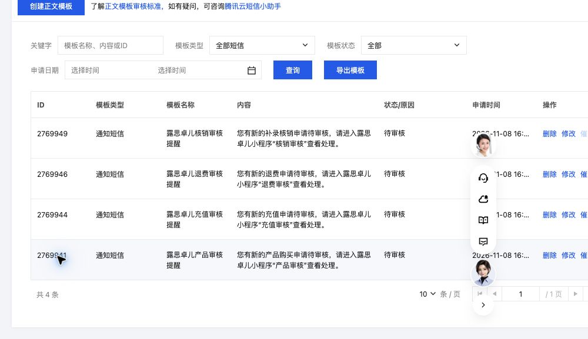

# 查询导出修复与短信模板配置

充值等工单应按工单ID校验。旧小程序代码优先选teacherId或customerCode，导致同一老师／客户的正常多笔订单被误判重复。现按每类实际身份字段处理，重复校验本身保留；Web同时加强产品真实明细行编号校验。测试直接连接现有服务端响应映射及隔离数据库查询DTO，避免只有简化合成数据通过。

另修复产品ALL筛选的数字编号错误及字体加载／写文件后的过期响应打开问题。小组总览的误露出导出入口移除，保留既有成员考勤日报导出权限。

PDF和XLSX表格正文、对应表头右对齐，标题与日报正文保持正常段落。生成30个查询、每日和总览样板；16份PDF共22页全部渲染，文字均在页内，14份XLSX逐个导入并渲染，所有表格单元格右对齐且不换行。手机390同一老师／客户8笔充值与iPad834的8笔核销实际调用微信文件写入和打开接口，PDF、Excel均成功。

808项测试及179项隔离数据库检查通过。此次无SQL，无数据库业务写入，无云函数修改。Web15个范围内文件已通过--safe --verify发布，公开地址SHA-256全部一致；保留发布前备份，无prune。0.3.64开发版取得官方最终上传回执，主包1,735,859字节、总包3,563,272字节；297份源码和原项目配置前后不变，IDE未重启。未设体验版、提审或正式发布；微信体验版后台此前被自动安全审查阻止，未绕过。源码dc70f7504b4f7e73228720589dabd2c074b6e278已推送。回执：deployments/2026-11-08-export-identity-verification.json。

## 四类短信模板

|用途|模板ID|正文|
|---|---|---|
|产品审核|2769941|您有新的产品购买申请待审核，请进入露思卓儿小程序“产品审核”查看处理。|
|充值审核|2769944|您有新的充值申请待审核，请进入露思卓儿小程序“充值审核”查看处理。|
|退费审核|2769946|您有新的退费申请待审核，请进入露思卓儿小程序“退费审核”查看处理。|
|核销审核|2769949|您有新的补录核销申请待审核，请进入露思卓儿小程序“核销审核”查看处理。|

签名“露思卓儿”ID733011。以上均已提交，提交后核验为待审核；企业资质已通过。实际发送仍需签名、模板、运营商报备完成及服务端发送服务上线。四类接收默认关闭，本次未发送任何短信，不改任何总部人员偏好。

