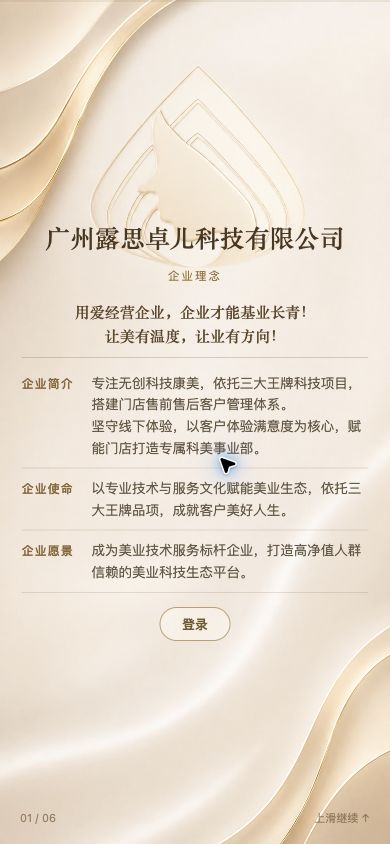
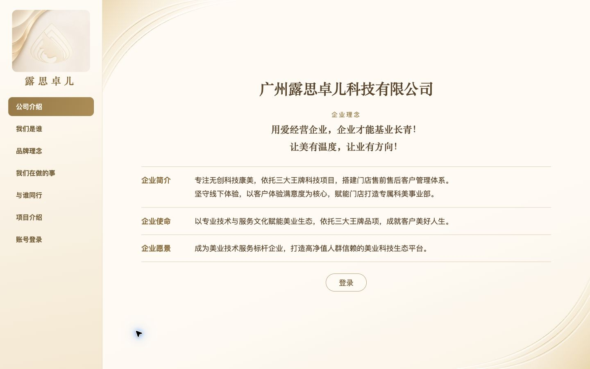
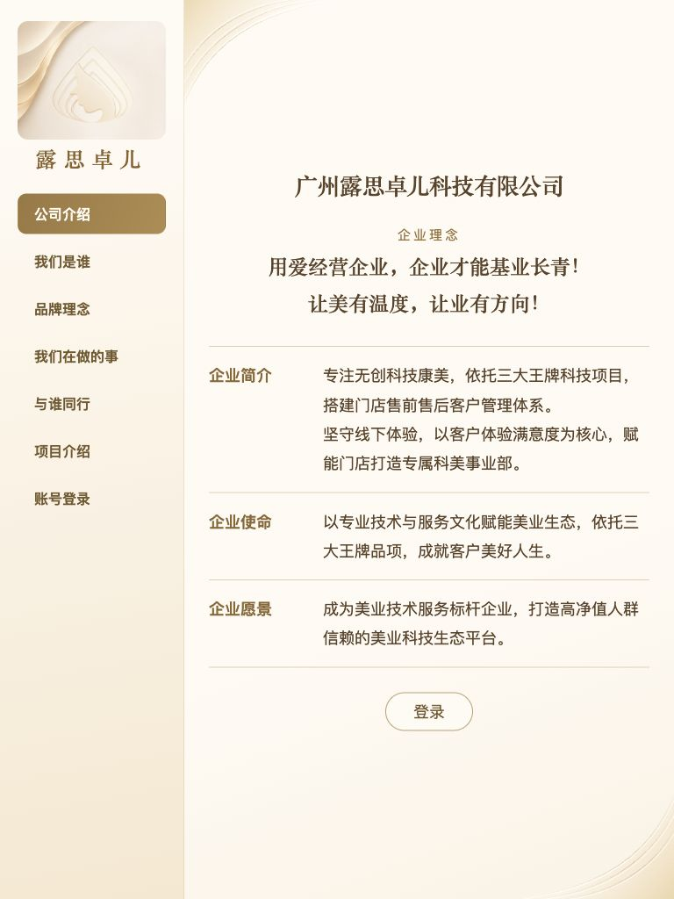

# 企业官网跨屏展示验收

本轮仅修改根目录公开公司页与三个项目介绍页。手机采用已批准小程序的六屏展示、同源花纹、阅读进度、轻量登录入口及项目图解；超过650px保留原左侧栏目和限宽正文。没有改动小程序源码、总部业务页面、身份矩阵、充值、核销、余额、照片上传或审核逻辑。

内容与象牙白／香槟金／深咖配色沿用既有批准版本。参考[克丽缇娜官网](https://www.chlitina.com.cn/)的页面层级、图文比例和导航组织，仅用于评估适配方式；没有引入其图片、字体、宣传、规模或产品内容。公开文案仍在Web文件内独立维护，没有引用小程序运行时代码。

## 浏览器检查

- 公司页：320×568、390×844、430×932、650×900、768×1024、1024×768、1440×900、1920×1080。手机六屏正文不越界，短屏按内容自然增高；iPad和电脑一次只显示所选栏目，侧栏保留。
- 电脑与iPad：768、1024、1280、1440、1920px检查公司介绍、项目入口和三个项目详情，共25组视口／页面组合。无页面横向溢出、标题或正文裁切；项目图按可用宽度180—260px，不使用手机满屏图。
- 三个项目：320、390、430px逐一切换三章节，共27组检查，一次仅显示一个章节，图解状态同步，按钮和正文未越界。
- 实际点击了公司翻页、项目入口、章节切换、登录与返回入口；保持原总部账号密码登录边界，没有用生产账号制造业务数据。
- 发现并修复了翻页时旧桌面控制器临时隐藏其它屏造成的滚动竞争；手机六屏保持挂载，导航定位和滚动回调使用独立帧，连续五次翻页依次到达02—06屏。
- 720项全仓回归通过，包含原充值／核销／补录／审核／权限／BLE／照片及Web路由契约；补充同一导航控制器手机六屏与登录隔离断言。未修改任何云函数或数据库。

几何记录：[layout-checks.json](assets/2026-11-08-public-mobile/layout-checks.json)。浏览器截图为真实Web页面，手机尺寸不代表已在真实微信内置浏览器和Safari硬件上验收。

## 域名与发布边界

`lusizhuoer.com`已购买，网站备案仍为管局审核中。已完成证书和CloudBase域名归属TXT验证；证书已签发，覆盖主域名与www，到期时间控制台显示2027-02-05 19:59:59。没有购买套餐、开启付费边缘加速、启用付费续费或下载私钥。90天证书到期前需重新申请／更新部署，不表述为永久自动续期。

CloudBase网关添加表单已验证归属并选取有效证书，但刷新后的自定义域名列表仍为空。主域名与www的CNAME、静态网站路由及根路径入口均尚未配置，不能把准备完成写成域名已经上线；须待备案通过后完成接入。现有托管首页配置和业务入口没有为此改变。依据：[CloudBase自定义域名接入要求](https://docs.cloudbase.net/service/custom-domain)。私有DNS前后配置、证书和备案原始回执只保存在本机私有目录。

Web源码推送与8份静态资源部署状态，另见后续独立发布记录；本文件本身不证明已部署。无SQL、无云函数发布、无小程序上传。
