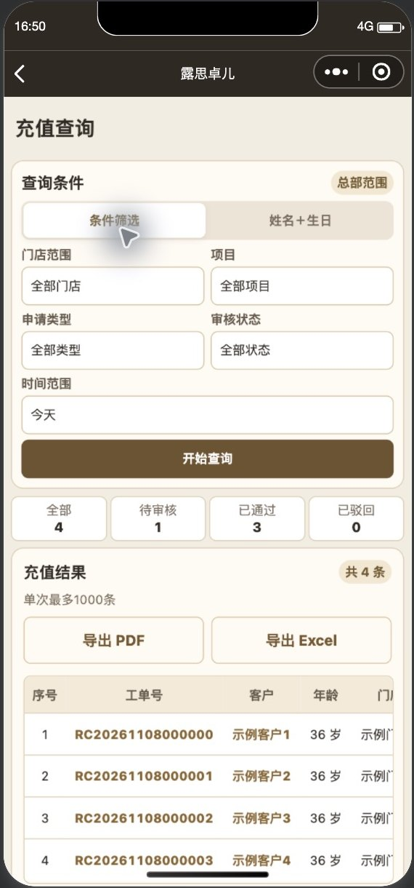
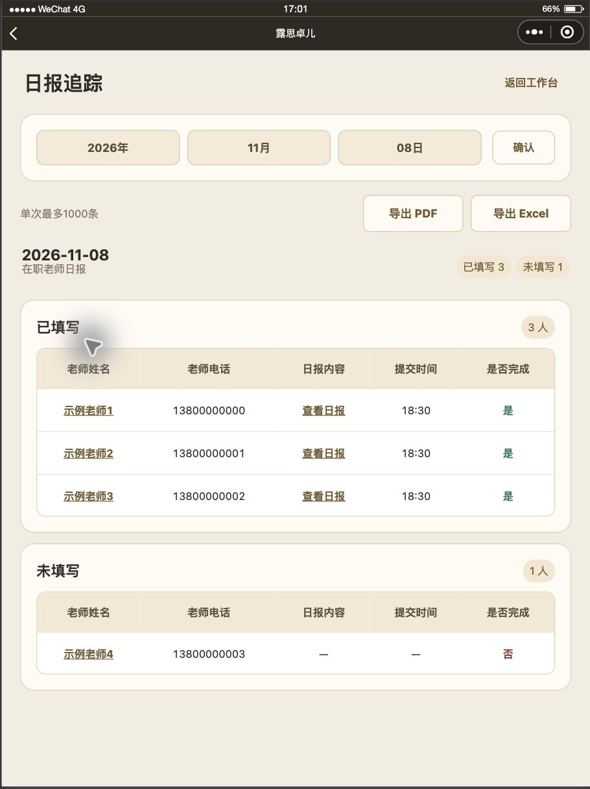
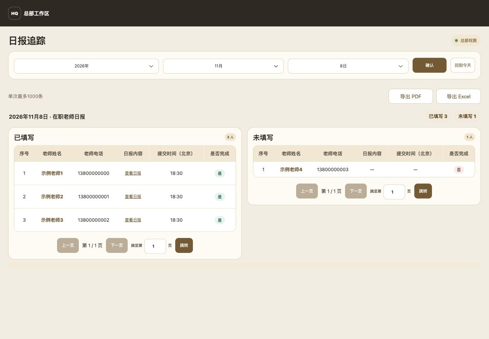
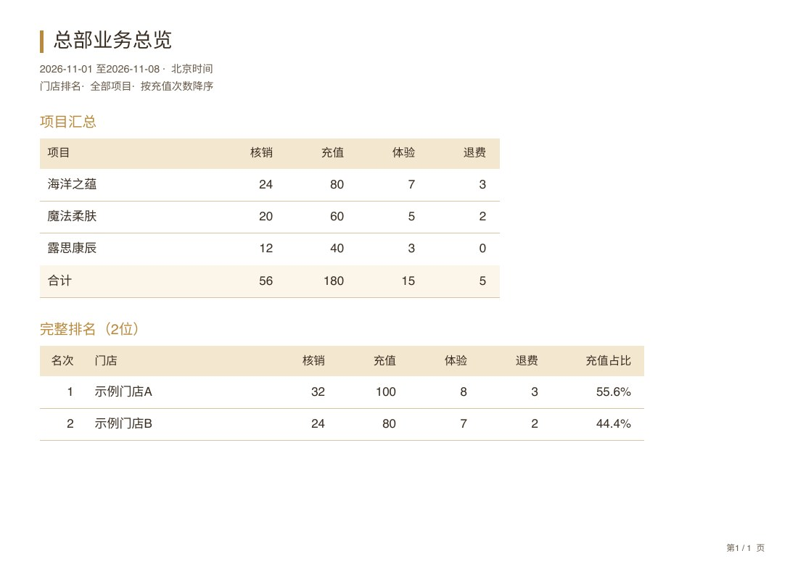
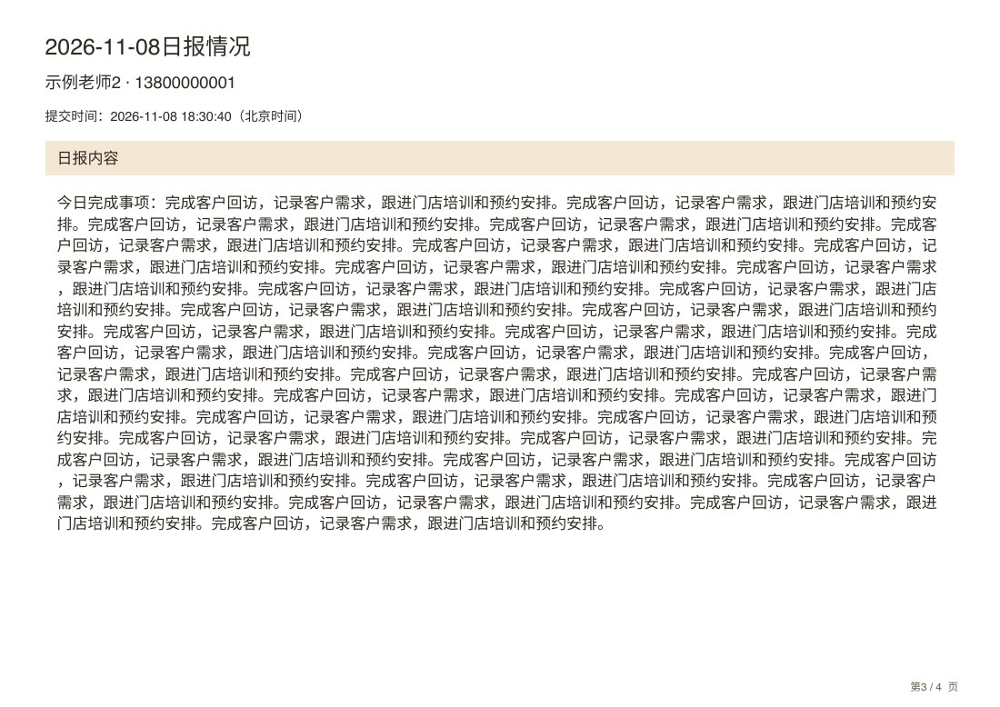

# 查询、每日考勤和日报导出

客户、充值／退费、核销和产品查询新增 PDF、Excel，导出当前条件的全部匹配结果，单次最多1000条。超过上限明确拒绝，不能把当前10条或前1000条伪装为完整结果。产品按来源与明细行识别，同一充值单的多个赠品和以后新增的产品类别均保留。

总部可导出每天全部在职老师考勤、日报；小组长只导出当前分配组员，普通老师、门店及跨组请求不能扩大范围。打卡仅汇总，不读取照片。日报PDF先汇总，后面每位已填写老师独立起页，长历史内容仅该老师续页；未填写仅列汇总。日报Excel分“当天汇总”“详细内容”，正文在独立段落区，保留历史字段。

表格文字单行，PDF12–13pt、Excel12pt，内容决定列宽，较宽内容增加横向纸张宽度而不缩字。总部总览保留项目汇总与排名，短数据同页紧凑排版，不强制每列铺满整页。中文字体嵌入，ASCII使用Helvetica真实字符宽度，避免中英文之间多余空白。客户导出显示年龄，不含生日、内部编码、照片或留言。

后台导出只执行一条有界SELECT，不逐页拼接，不逐人读取日报。既有展示分页、业务统计和审核写入保持原样。无新SQL、生产数据修改或手机号／认证操作。

## 验证

- 全仓756项回归通过，包括正常、体验、补录、扣次、审核、照片和权限。
- 新增9项运行时检查：1000／1001边界、一个SQL快照、门店范围、赠送明细、组员范围、完整21条结果、换账号与换筛选失效、实际PDF／XLSX字节及日报分页。
- 隔离PGlite：业务统计161项、组长114项、每日导出18项通过；产品查询、动态品类和1000／1001赠品明细通过。生产写入为0。
- 小程序隔离原生320机型已成功调用PDF、Excel打开接口并显示已导出4条；手机390／430、iPad768／834／1024竖屏和1024横屏均核对新增入口。Web320／390／834／1280／1440没有页面横向溢出，两个导出按钮等宽、同高、同一行。原列表仅允许既有表格内部横向滚动。
- 逐类渲染22份PDF、20份真实XLSX（22个工作表），包括37条跨门店分页、长姓名、长项目名、多赠品明细、1000字日报；所有PDF文字均在纸张边界内，表格数据不换行、Excel无公式注入。日报正文为独立段落，正常换行；筛选说明是表格外合并区域。
- 实际生成文件合成为47页带目录／书签的样板PDF，并附全部原文件压缩包，位于本地`output/pdf/2026-11-08-export-layout-examples.pdf`及`2026-11-08-all-export-samples.zip`。全部样板使用合成数据。
- 本机Node对1000条合成结果的生成耗时：PDF128ms、XLSX50ms；这是纯本地生成测量，不代表手机性能、网络读取或端到端时延。后台只取一次有界快照，打卡不下载照片，字体仍按需加载。

## 发布状态

- staffAccount v105、faceRecognition v143已通过官方开发者工具明确函数路径部署；线上health版本正确，分别下载6／7个源文件，与本地逐一SHA-256一致。归档根README、运行版本、package版本及ZIP文件名一致。
- Web46个范围内文件已使用`--safe --verify`发布，无`--prune`，根路径省略cloudPath参数；发布前保留旧文件，发布后46个公共URL字节SHA-256全部匹配。
- 小程序0.3.63开发版已取得官方最终`✔ upload`回执；主包1,735,057字节、总包3,566,203字节。复用健康IDE，无重启；上传前后249个受控客户端文件及用户原有project.config.json均未变化。用户未追踪图片继续排除。
- 无新SQL，没有生产数据库、认证或业务记录写入。正式微信发布后台此前受自动安全审查阻止，本次未绕过；未设置体验版、未提审、未正式发布。
- 发布证据：`deployments/2026-11-08-query-export-verification.json`；私有日志、登录信息和读取的代码包仅留本地，不进Git。

## 目视样例

