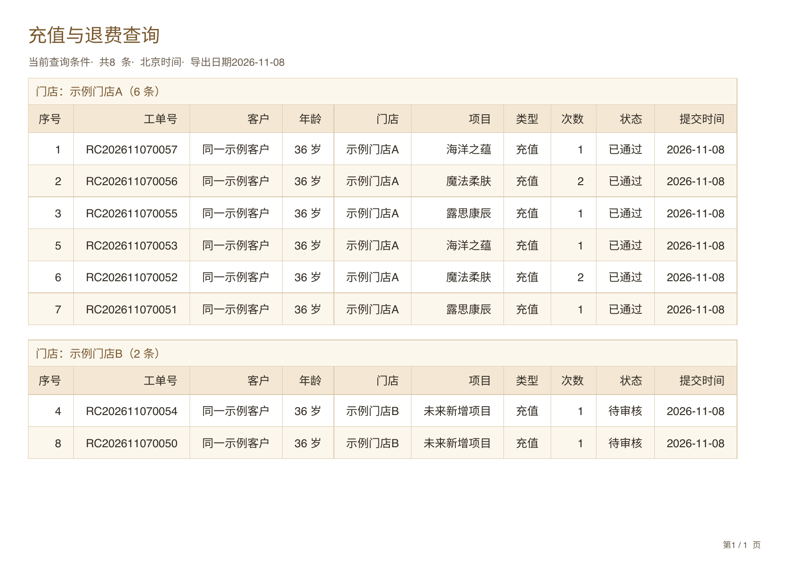
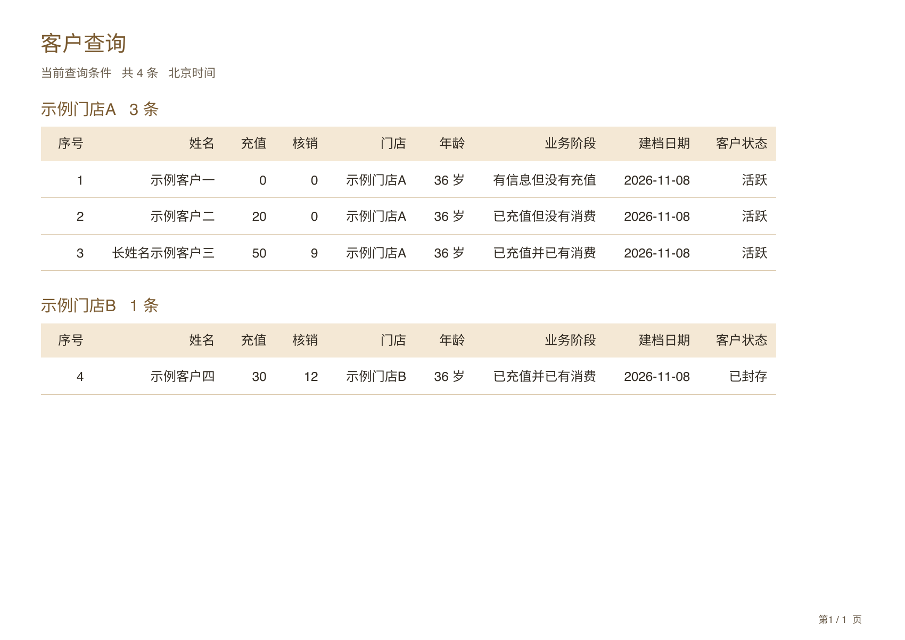

# 查询列与导出列一致性修正

修复小程序查询导出未定义门店列、通用PDF渲染器按字段名移除门店列、Web的PDF与Excel列定义不同三处问题。客户、充值／退费、核销、产品查询按本端实际查询表格对齐字段、表头及顺序，门店在每条明细中保留。Web查询原有客户编号列同步导出；小程序仍不新增其页面未显示的客户编号。门店、产品、项目和老师内部编码不新增。

活跃、余次、评价分析PDF同样保留既有列定义中的门店。此前明确移除的计算起点继续不导出。日期仍仅北京时间日期，PDF／Excel表格右对齐、单行、原字号、自适应列宽和1000条边界不变。Web同列定义的各门店分组共用列宽，避免跨组位置跳动。

新增10项回归：直接从实际WXML与Web查询HTML读取表头，比较PDF／XLSX模型、真实XLSX表头与PDF门店表头输出；校验相同字段的跨组列对齐。818项完整回归通过。生成22份PDF和20份XLSX；46页PDF已渲染、文件文字边界检查通过，20份XLSX经导入渲染检查。原生手机390充值8条PDF／Excel成功；iPad834客户4条PDF／Excel成功。

此次仅客户端导出与Web排版，无SQL、云函数或生产业务数据写入，不改变查询、审核、余额或核销。源码和发布回执完成后补充。

