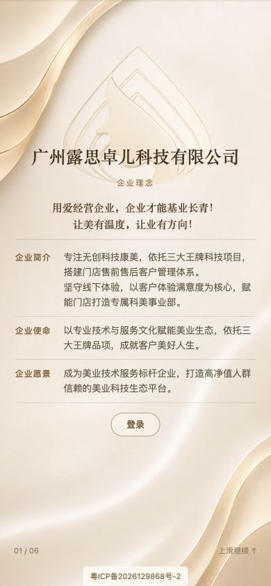

# 企业官网正式域名上线

正式入口：[https://lusizhuoer.com/](https://lusizhuoer.com/)。2026-11-17 在腾讯云备案控制台核对，网站备案已通过，网站号为 **粤ICP备2026129868号-2**。本记录取代 2026-11-08 发布记录中的“等待备案和自定义域名接入”状态。

## 域名与首页

- 修复既有主域名绑定，沿用已签发证书，不下载私钥。HTTP 网关域名状态及证书状态均为正常。
- DNSPod 新增 `@` CNAME，指向平台给出的 `lusizhuoer.com.tcbaccess.tencentcloudbase.com`，TTL 600。两条原 TXT 验证记录保留。
- `/` 路由关联原静态托管根目录，默认索引文档由 `index.html` 改为 `login.html`。直接打开域名进入公司介绍；显式 `/index.html` 仍是原总部业务后台。
- 启用 `HTTP -> HTTPS`。直接 TCP HTTP 请求验证为 307，Location 保留查询参数并指向 HTTPS；证书链与主机名经系统信任库独立验证通过。
- 主域名已出现在平台安全来源名单；保留所有原来源及原鉴权，不降低登录或业务权限。
- 当前个人版添加第二个自定义域名会提示升级套餐，故 `www` 尚未绑定；没有购买套餐或付费边缘加速。正式传播使用不带 www 的入口。

## 备案展示与跨屏验收

公司介绍、登录界面及三个项目页均显示网站备案号，并链接至 `https://beian.miit.gov.cn/`。公司手机六屏底部的备案号和翻页控件分层排列；项目页备案号随正文位于页尾，避免浮层遮住内容。颜色、公司文案、三项目内容及原业务入口保持原实现。

公网检查 390×844 手机、768×1024 iPad、1424×655 桌面。320×568 窄屏检查全部六屏，无横向溢出；服务内容较长时允许纵向完整阅读。手机备案链接与翻页链接的实际边界无重叠。三项目手机页面图片均加载完成、各仅显示一个章节，章节切换正常；匿名打开业务后台仍返回原登录页。没有使用生产账号提交登录或业务数据，也未宣称完成真实手机 Safari／微信硬件测试。

[iPad 效果](assets/2026-11-17-website-tablet.jpg) · [电脑效果](assets/2026-11-17-website-desktop.jpg)

## 发布与校验

仅发布 `company-filing.css`、`login.html`、`public-project.html` 三个公开 Web 文件。独立暂存目录，CloudBase CLI 3.9.3，`--safe --verify --concurrency 1 --entry login.html,public-project.html`，根路径参数省略，不使用 prune。服务端先备份后发布；官方最终回执：3 文件成功、0 失败、verified=true。既有静态资源较多，备份阶段约九分钟，期间未重试或并发上传。

公网逐字节 SHA-256 回读三文件与源码一致，根地址内容等同新 `login.html`；`index.html` 与发布前及本地源码完全相同。HTML Content-Type 正常，未带下载附件头。公开核验摘要见 [JSON](assets/2026-11-17-website-domain-verification.json)。发布前配置、原 HTML、DNS 状态、官方上传回执及私有运维证据保存在被 Git 忽略的独立目录；没有把账号数据、备案数据码、令牌或私钥提交到仓库。

844 项完整回归通过，360 份受版本管理 JavaScript 语法检查通过；最后项目页页脚位置调整后，补跑 Web 展示、链接和总部登录限制检查通过。此次没有 SQL、生产数据库写入、云函数修改、小程序上传，也未切换客户评价二维码生成地址。

## 后续维护

- **公安联网备案未完成**：ICP 数据同步不等于公安备案办结。已打开官方入口核对独立登录步骤，用户明确选择稍后办理；没有代为注册、实名或提交，没有编造公安备案号。按[腾讯云指引](https://cloud.tencent.com/document/product/243/120137)继续办理。
- 当前证书到期：**北京时间 2027-02-05 19:59:59**；没有开启或承诺自动续期。
- 如需回退首页路由，索引文档原值为 `index.html`；改回会恢复原根入口。三份发布文件的原文件和远端安全备份均保留，任何回滚仍须先核对当前远端状态，不能覆盖后续发布。
